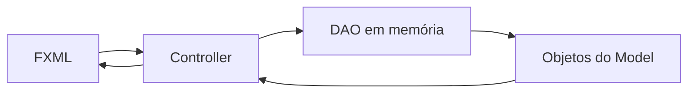

# Arquitetura simples do Mercatto

A organização segue o exemplo `ExemploJavaFx` enviado para a atividade: `main`, `model`, `model.dao`, `controller` e telas FXML. O Maven organiza os arquivos para executar no IntelliJ com JavaFX 21.

## Comparação com o exemplo

| No exemplo | No Mercatto |
|---|---|
| `main/NewMain` | `main/Main`, que carrega a tela principal |
| `model/Cliente` | Classes `Produto`, `Cliente`, `Carrinho`, `Venda`, itens e pagamentos |
| `model/dao/ClienteDAOImpl`, usando `ArrayList` | `ProdutoDAO`, `ClienteDAO` e `VendaDAO`, cada um com sua lista privada |
| Controller chama o DAO | Cada controller chama diretamente os DAOs de que precisa |
| Arquivo FXML com controller associado | Nove FXML com controllers de construtor padrão |

Os DAOs são classes concretas para manter a estrutura curta. A implementação é exclusivamente em memória. `Dialogos` é uma interface pequena usada para exibir mensagens na aplicação e verificar erros nos testes.

## Como as telas compartilham os dados

`Main` cria `DadosAplicacao`, que reúne os três DAOs e o carrinho. Essa instância pertence à execução atual e não usa estado global estático. Criar outra instância gera coleções vazias e independentes.

O início da aplicação segue a mesma sequência de carregamento do exemplo:

```java
FXMLLoader loader = new FXMLLoader(getClass().getResource("/br/com/mercatto/view/principal.fxml"));
Parent raiz = loader.load();
PrincipalController controller = loader.getController();
controller.iniciar(dados, dialogos);
```

Para abrir Produtos, o principal carrega o FXML, obtém o controller e passa sua própria referência:

```java
FXMLLoader loader = new FXMLLoader(getClass().getResource("/br/com/mercatto/view/produtos-consulta.fxml"));
Parent tela = loader.load();
ProdutosConsultaController controller = loader.getController();
controller.setPrincipal(this);
```

O controller recebe o mesmo DAO que as demais telas utilizam:

```java
public void setPrincipal(PrincipalController principal) {
    this.principal = principal;
    this.produtoDAO = principal.getDados().getProdutoDAO();
    atualizar();
}
```

Ao salvar um produto, o controller chama `produtoDAO.salvar(...)`. O DAO valida os campos e inclui o objeto na lista, ou atualiza a instância existente. Ao consultar, `produtoDAO.consultar(...)` devolve referências aos produtos dessa lista.

O botão **Adicionar ao PDV** passa o `Produto` selecionado para o principal, que o entrega ao controller do PDV. O carrinho guarda esse mesmo objeto. No pagamento, `VendaDAO.finalizar(...)` valida a venda e altera o estoque desses produtos. A consulta mostra o estoque atualizado.

## Fluxo de uma venda



As telas principais ficam abertas internamente para preservar buscas, filtros e o carrinho ao alternar módulos. Os formulários, o pagamento e os detalhes são modais abertos pelo principal. O mesmo formulário de produto atende o gerenciador e o cadastro iniciado no PDV.

## Onde estudar primeiro

1. `main/Main.java`: carregamento inicial e criação dos dados da execução.
2. `model/Produto.java`: atributos privados, construtor, getters e setters.
3. `model/dao/ProdutoDAO.java`: lista, cadastro, consulta, edição e exclusão.
4. `controller/ProdutoFormularioController.java`: leitura dos campos e chamada do DAO.
5. `controller/PrincipalController.java`: navegação e passagem de referências.
6. `controller/PdvController.java` e `model/dao/VendaDAO.java`: movimentação e estoque.
7. `model/Pagamento.java` e subclasses: herança e polimorfismo.

As regras e as telas da versão anterior foram preservadas. A mudança está na organização e no carregamento: os controllers usam os DAOs diretamente e não dependem de fábrica, camada de serviços ou navegador separado.
