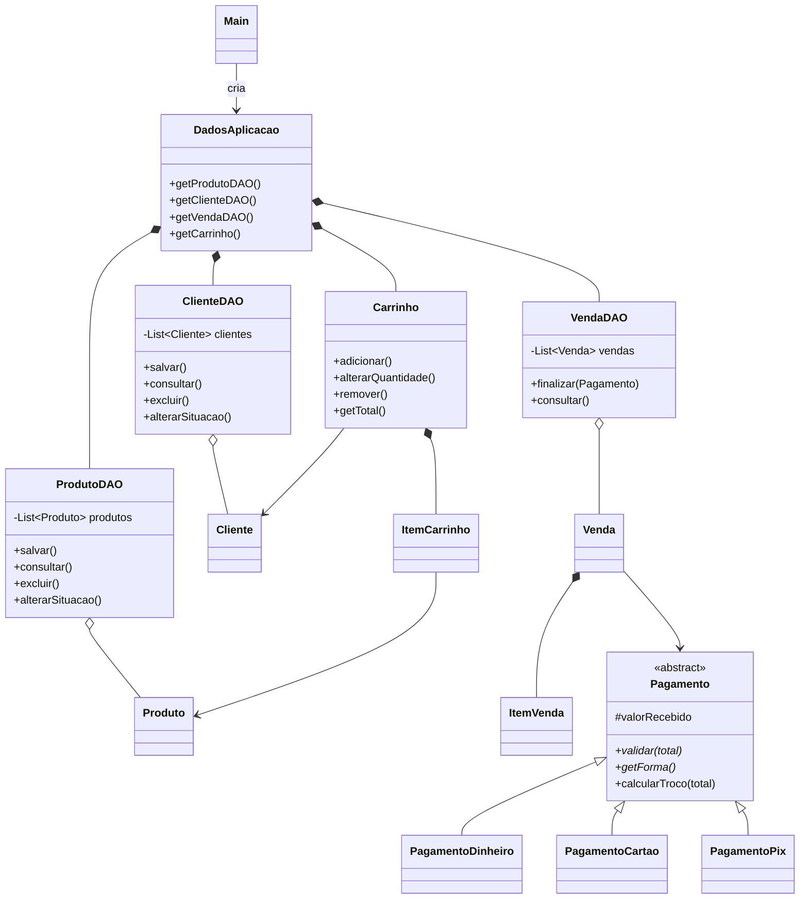
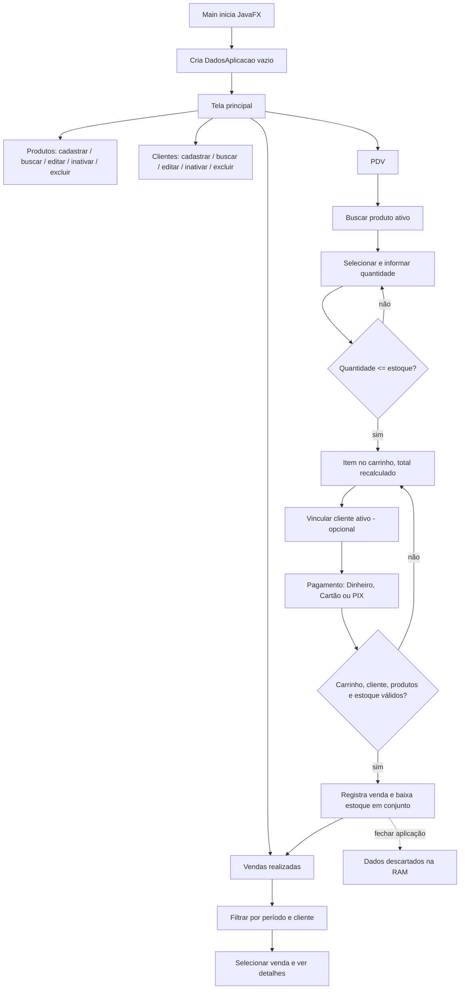

# Mercatto — ERP para Mini Mercados e Varejos

Trabalho bimestral — UNICIVE.

## 1. Integrantes

| Integrante | R.A. |
|---|---|
| Ana Clara Rodrigues | 412664-2025 |
| Victor Hugo Lopes Balena | 408905-2025 |
| Rafael José Urtado de Brito | 394405-2025 |
| Gustavo Henrique Lopes Balena | 409628-2025 |

## 2. Descrição do funcionamento

O Mercatto é um sistema desktop para mini mercados e pequenos varejos, feito em Java 21 com JavaFX 21 e telas FXML editáveis no Scene Builder. Reúne quatro módulos: **Produtos**, **Clientes**, **PDV** (registro de venda) e **Vendas realizadas**.

Os dados ficam apenas em coleções na memória RAM, compartilhadas entre as telas durante a execução. Ao fechar a aplicação tudo é descartado e a próxima execução começa vazia.

| Módulo | O que faz |
|---|---|
| Produtos | Cadastrar, buscar por nome/código, editar, inativar e excluir (com confirmação). Excluir é bloqueado se o produto já pertence a uma venda ou está no carrinho. |
| Clientes | Cadastrar nome, CPF/CNPJ e telefone; buscar; editar, inativar e excluir (com confirmação). Cliente usado em venda só pode ser inativado. |
| PDV | Buscar produto ativo, informar quantidade (validada contra o estoque), montar o carrinho com total recalculado a cada alteração, vincular cliente (opcional) e escolher Dinheiro, Cartão ou PIX. |
| Vendas realizadas | Filtrar por período e cliente, selecionar uma venda e ver itens, valores, pagamento e cliente (ou "não identificado"). |

Regras principais: campos obrigatórios validados; finalização impedida com carrinho vazio ou quantidade acima do estoque; todos os itens são validados antes de qualquer alteração, de modo que não há baixa parcial de estoque.

## 3. Estrutura das classes

```text
br.com.mercatto
  main/        Main, Launcher
  model/       Produto, Cliente, Carrinho, ItemCarrinho, Venda, ItemVenda,
               Pagamento (abstrata), PagamentoDinheiro, PagamentoCartao, PagamentoPix,
               FormaPagamento (enum), Validacao, RegraNegocioException
  model/dao/   ProdutoDAO, ClienteDAO, VendaDAO, DadosAplicacao
  controller/  PrincipalController, ProdutosConsultaController, ProdutoFormularioController,
               ClientesConsultaController, ClienteFormularioController, PdvController,
               PagamentoController, VendasConsultaController, VendaDetalhesController
  util/        Dialogos, DialogosJavaFx, Formatos, Tabelas
resources/br/com/mercatto/view/   9 arquivos FXML
resources/br/com/mercatto/css/    mercatto.css
```



Arquitetura em camadas (MVC simples): **FXML/CSS** (visão) → **controllers** (eventos) → **DAOs** (listas em memória e regras de cadastro/venda) → **model** (entidades).

## 4. Conceitos de POO utilizados

- **Encapsulamento:** `Produto` e `Cliente` têm atributos privados; construtores e setters rejeitam estados inválidos (preço ≤ 0, estoque negativo, documento ou telefone em formato inválido).
- **Abstração:** `Pagamento` é uma classe abstrata que define o contrato comum (`validar`, `getForma`, `calcularTroco`) sem se preocupar com o meio de pagamento.
- **Associação e composição:** `DadosAplicacao` compõe os três DAOs e o `Carrinho`; `Carrinho` compõe seus `ItemCarrinho`; `Venda` compõe seus `ItemVenda`. `ItemCarrinho` apenas se associa a um `Produto`.
- **Imutabilidade de histórico:** `ItemVenda` guarda cópias de código, nome e preço; editar o catálogo depois não altera vendas já concluídas.
- **Enumeração:** `FormaPagamento` limita as formas a Dinheiro, Cartão e PIX.
- **Tratamento de erros:** `RegraNegocioException` e `Validacao.exigir` concentram as mensagens de validação exibidas ao usuário.
- **Programação por interface:** `Dialogos` é implementada por `DialogosJavaFx` em produção, e por uma implementação de teste.

## 5. Passagem de dados entre telas

1. `Main` cria **uma única** instância de `DadosAplicacao` (DAOs + carrinho) e a entrega ao `PrincipalController` com `iniciar(dados, dialogos)`.
2. Para abrir uma tela, o principal carrega o FXML com `FXMLLoader.load()`, obtém o controller com `getController()` e chama `setPrincipal(this)`.
3. Dentro de `setPrincipal`, o controller lê os DAOs compartilhados: `principal.getDados().getProdutoDAO()`.
4. Todas as telas enxergam os mesmos objetos. Ao selecionar um produto na consulta e clicar em **Adicionar ao PDV**, é a mesma instância de `Produto` que vai para o `PdvController` e para o `ItemCarrinho` (os dados não são reconstruídos a partir do texto da tabela).
5. Formulários, pagamento e detalhes são modais abertos pelo principal. O formulário valida um objeto candidato e só então altera o cadastro; cancelar não modifica nada.

```java
FXMLLoader loader = new FXMLLoader(getClass().getResource("/br/com/mercatto/view/produtos-consulta.fxml"));
Parent tela = loader.load();
ProdutosConsultaController controller = loader.getController();
controller.setPrincipal(this);
```

## 6. Herança

A hierarquia está em `Pagamento`:

- `Pagamento` (abstrata) guarda `valorRecebido`, declara `validar(total)` e `getForma()` como abstratos e implementa `calcularTroco(total)` (troco zero) e `validarValorExato(total)`.
- `PagamentoDinheiro`, `PagamentoCartao` e `PagamentoPix` estendem `Pagamento` e implementam os métodos abstratos. Cartão e PIX exigem o valor exato; Dinheiro aceita valor maior ou igual ao total.

Também há herança de exceção: `RegraNegocioException` estende `RuntimeException`.

## 7. Polimorfismo

- **Sobrescrita:** `PagamentoDinheiro` sobrescreve `calcularTroco` (valor recebido − total); Cartão e PIX herdam o troco zero.
- **Chamada polimórfica:** `VendaDAO.finalizar(Pagamento pagamento)` recebe o tipo base e chama `pagamento.validar(total)`; `Venda` usa `getForma()` e `calcularTroco`. O código não verifica qual é o tipo concreto: a JVM escolhe a implementação conforme o objeto criado pelo `PagamentoController` (Dinheiro, Cartão ou PIX).
- Para incluir uma nova forma de pagamento basta criar uma nova subclasse; `VendaDAO` não muda.

## 8. Fluxo da aplicação



## 9. Requisitos e decisões

| Requisito | Onde está atendido |
|---|---|
| RF001–RF003 (produtos) | `ProdutoDAO`, `ProdutoFormularioController`, `ProdutosConsultaController` |
| RF004–RF006 (clientes) | `ClienteDAO`, `ClienteFormularioController`, `ClientesConsultaController` |
| RF007–RF009 (busca, itens, total) | `PdvController`, `Carrinho` |
| RF010–RF012 (cliente, pagamento, finalização) | `PdvController`, `PagamentoController`, `VendaDAO.finalizar` |
| RF013–RF014 (consulta e detalhes) | `VendasConsultaController`, `VendaDetalhesController`, `VendaDAO.consultar` |
| NF001 (Java/JavaFX/FXML) | 9 FXML separados de controllers e model |
| NF002 (2 passos no PDV) | Busca e seleção; Enter adiciona |
| NF003 (validação) | `Validacao`, formulários, `VendaDAO.finalizar` |
| NF004 (busca ≤ 1 s com 1.000 produtos) | Teste `buscaComMilProdutosRetornaEmAteUmSegundo` |
| NF005 (consistência do estoque) | Validação prévia e restauração em `VendaDAO.finalizar` |
| NF006 (RAM) | Listas em memória nos DAOs, sem persistência |

Decisão: no cadastro de produto são obrigatórios descrição e preço positivo; o código é gerado automaticamente quando omitido e o estoque inicial é zero. O documento de requisitos não define a lista exata de campos obrigatórios.

## 10. Como executar

Requisito: JDK 21 ou superior. No IntelliJ, abra o `pom.xml` como projeto Maven e execute `br.com.mercatto.main.Launcher`. Pelo terminal: `.\iniciar.ps1`. Testes: `.\mvnw.cmd verify`.
