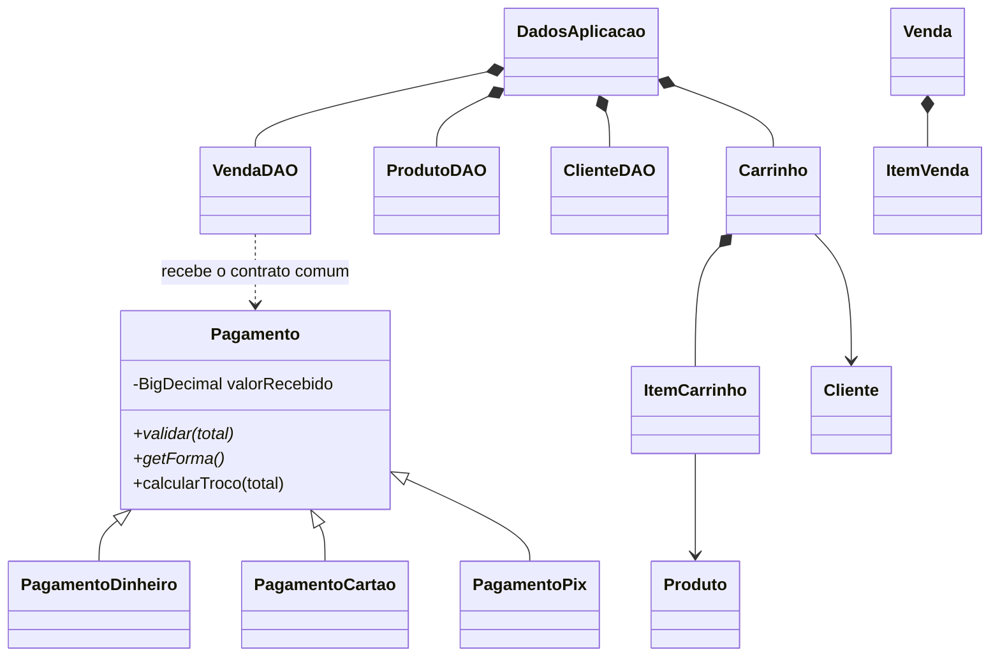

# POO aplicada no Mercatto

## Encapsulamento e construção

`Produto` e `Cliente` encapsulam seus atributos. Seus construtores e setters rejeitam estados inválidos. Por exemplo, `Produto.setPrecoVenda` rejeita zero, negativos e mais de duas casas decimais; `baixarEstoque` impede estoque negativo. Os DAOs verificam também condições que envolvem vários objetos, como código/documento exclusivo e vínculos de vendas.

Os formulários validam um objeto candidato antes de modificar o cadastro compartilhado. Cancelar um formulário não altera o objeto original. A edição bem-sucedida mantém a identidade da instância, permitindo que outras telas reconheçam o mesmo produto ou cliente.

## Associação, composição e passagem de objetos

`DadosAplicacao` reúne um `ProdutoDAO`, um `ClienteDAO`, um `VendaDAO` e um `Carrinho`. Cada DAO possui sua própria lista privada de objetos. Uma única instância de `DadosAplicacao` é criada em `Main` e enviada ao `PrincipalController` pelo método `iniciar`.

As demais telas são carregadas com o `FXMLLoader` padrão. O principal obtém o controller com `getController()` e chama `setPrincipal(this)`. Esse método permite que o controller acesse os mesmos DAOs e o mesmo carrinho. É uma passagem explícita de referências entre objetos, sem fábrica de controllers.

Na consulta, a seleção da tabela é um objeto `Produto`. O botão **Adicionar ao PDV** envia esse objeto ao `PdvController`, que o associa a um `ItemCarrinho`. A seleção de cliente utiliza o mesmo princípio. Os dados não são reconstruídos a partir dos textos da tabela.

O carrinho possui seus itens e calcula seu total com `BigDecimal`. O item associa um produto, sua quantidade e a cotação unitária. Uma venda concluída possui itens imutáveis (`ItemVenda`) com cópias dos dados necessários ao histórico. `ItemVenda` é uma classe comum, com atributos privados, construtor e getters. Isso permite editar o catálogo posteriormente sem alterar uma venda anterior.

## Herança, abstração e polimorfismo

`Pagamento` reúne o valor recebido e define o contrato de validação. Cada subclasse implementa `validar` e `getForma`. Dinheiro também sobrescreve `calcularTroco`; Cartão e PIX usam o comportamento comum de troco zero e exigem o valor exato.

O código de venda usa `pagamento.validar(total)` e `pagamento.calcularTroco(total)`. A execução seleciona a implementação adequada conforme o objeto concreto. Não há uma verificação de tipo dentro de `VendaDAO` para calcular o pagamento. A escolha da implementação ocorre no controller da tela de pagamento.

Cada controller é uma classe independente, sem classe base obrigatória. O exemplo de herança está nas formas de pagamento. `Dialogos` demonstra programação por interface, com uma implementação gráfica em produção e uma implementação controlada nos testes.

## Responsabilidades

| Parte | Responsabilidade |
|---|---|
| FXML e CSS | Apresentação e organização dos controles |
| Controllers | Coletar entrada, chamar DAOs e atualizar a interface |
| Entidades | Estado e operações locais válidas |
| DAOs | Guardar listas em memória, consultar e validar cadastros e vendas |
| DadosAplicacao | Compartilhar os três DAOs e o carrinho da execução |
| PrincipalController | Trocar módulos e abrir formulários, pagamento e detalhes |

## Demonstração sugerida

1. Inicie a aplicação e mostre as listas vazias.
2. Cadastre um produto e um cliente usando os formulários.
3. Selecione o produto na consulta e envie-o ao PDV. Explique a passagem da instância selecionada.
4. Altere a quantidade. Tente uma quantidade acima do estoque e mostre a validação.
5. Selecione o cliente, vá ao pagamento e mostre o troco em dinheiro. Compare os comportamentos de Cartão e PIX.
6. Conclua a venda. Consulte o novo estoque e os detalhes da venda.
7. Edite nome/preço do produto e mostre que a venda concluída conserva os dados anteriores.
8. Mostre as subclasses de `Pagamento` e a chamada polimórfica em `Venda`.
9. Feche e reabra. Explique por que as coleções voltam a ficar vazias.

Os dados necessários à demonstração devem ser cadastrados durante a execução. O código de produção não inclui uma carga inicial de registros.
